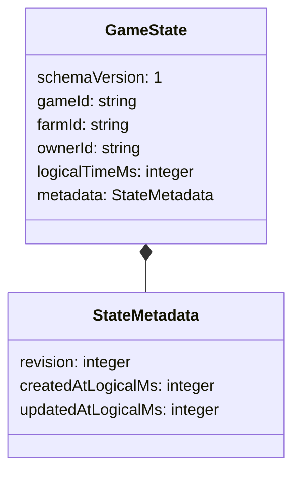

# FDS2-001 — Game State & Authority Contract

Status: **FDS2-001 PASS local** — 390 tests / 24 files, including 39 new contract
tests; lint, typecheck, production build and whitespace checks pass.
Decision date: 2026-11-07. Only the data/transition contract is implemented;
there is no save/load, database, backend, inventory or farming system.

## Baseline and placement decision

Sprint 1 checkpoint is committed as `3d2777413fc661038be6ff081af888d034412c4c`.
Working tree was clean. Codex verified Development Quality
[run 42351527639](https://github.com/chienng1512k6-ng/Trang-Trai/actions/runs/42351527639)
completed/success for that exact SHA before implementation. This is the newer
checkpoint after the earlier accepted [53692f9 CI run](https://github.com/chienng1512k6-ng/Trang-Trai/actions/runs/42351013684).
These runs certify the baseline, not the uncommitted FDS2-001 changes.

Implementation: [core/gameState.ts](../apps/game/src/core/gameState.ts), alongside
existing pure Player, collision, FSM and combat modules. There is only one real
consumer package today; do not create packages/core or packages/contracts merely
as scaffolding. Extract when a second consumer exists. No imports from Phaser,
DOM, rendering, storage, network, Date.now or Math.random; no dependency changes.
This contract is deliberately not connected to Scene/update or existing actors.

## Minimal schema v1



GameState is the **persistent-intent data envelope**, not an implemented save.
It contains one game/farm and a stable owner reference. ownerId is a domain ID,
not an email, auth token, Phaser actor name or proof of authentication. A separate
Player character ID is unnecessary until character/progression data exists.
gameId identifies this logical game timeline; farmId identifies its farm. IDs
are opaque, case-sensitive ASCII strings, 1–64 characters, matching
`[A-Za-z0-9][A-Za-z0-9._:-]{0,63}`. No trimming/coercion, automatic ID generation,
cross-record uniqueness lookup or UUID/auth-provider dependency is introduced.
Example local references such as owner-1 must never be mistaken for login.

logicalTimeMs is a nonnegative safe integer of elapsed milliseconds from this
game's chosen logical epoch. It is **not Unix time, Phaser Scene time, a frame
counter, online duration, world day count or a trusted offline duration**.
createdAtLogicalMs <= updatedAtLogicalMs <= logicalTimeMs on the same timeline.
Revision starts at zero by convention and increases on every accepted mutation;
validation accepts any nonnegative safe revision as a possible snapshot, without
claiming it proves the history. schemaVersion describes representation, while
revision describes concurrency. They are independent.

The caller explicitly supplies initial data and transition time. No scheduler,
elapsed-time accumulation, clock-skew policy, growth/rewards or offline simulation
is implemented. A future service will map trusted elapsed time onto this timeline
and store/reconcile subsystem timestamps under an approved persistence contract.

## State classification

| Class | Examples / treatment |
|---|---|
| Persistent-intent | Only the v1 envelope above is implemented. Future item quantities, plot ownership/crop lifecycle and construction timestamps require explicit schema/validation design before inclusion |
| Runtime transient | Current Player position/facing/motion and compensated integration error, Monster FSM/path/seed, HP/cooldowns/activation events, held keys/touch pointer IDs; remain owned by existing systems and are not copied into this envelope |
| Derived | Projected world/screen positions, collision AABBs derived from Tiled metadata, selected tile, distance/attack arc, foot-Y sort order; recompute rather than persist |
| Rendering-only | Phaser sprites/layers/camera objects, DOM HUD/buttons, animation frame, tint/flash/graphics and browser listener handles; never stored |

Current combat HP and Monster seed are runtime for this prototype even though
future designs could choose to persist selected domain values. That future choice
must be explicit; no automatic serialization of PlayerState/MonsterState/combat.
The 32×32 prototype terrain is not persistent land ownership, and the proposed
24×24 buildable area from GDD is not inferred from this envelope.

## Authority matrix

All current prototype gameplay runs locally. This contract validates consistency,
**not anti-cheat**. A caller controlling JavaScript can forge owner/context/state.
Future server responsibilities below are design requirements, not deployed code.

| Group | Current prototype / FDS2-001 | Future authoritative owner and required validation | Client role |
|---|---|---|---|
| Player progression | No progression subsystem | Server: identity, valid progression/reward rules, versioned definitions | Intent/UI/prediction; never grant XP/levels |
| Inventory/items | Not implemented | Server: item definitions, integer quantities/capacity, ownership, atomic/idempotent operations | Request transfer/use, render verified result |
| Currency | Not implemented | Server: integer ledger, prices, balances, operation IDs, transactional mutations | Display/request; never submit authoritative award/balance |
| Farming/crops | Not implemented | Server: owned plots, seed/resources, lifecycle, trusted time and bounded catch-up | Preview and display growth from validated state |
| Land ownership | Terrain only; no ownership system | Server: owner, contiguous expansion rules, price, occupancy and transactions | Placement/expansion preview |
| Buildings | Not implemented | Server: footprint/ownership/resources, occupancy, build timestamps/lifecycle | Preview/animation, submit command |
| Combat | Existing client-only movement/HP/damage/FSM unchanged | Future authority validates actors/range/cooldown/hits/rewards; no client-guaranteed economic rewards. Multiplayer real-time authority/reconciliation requires separate design | Local prototype simulation; later input/prediction/feedback |
| Cosmetic ownership | Not implemented; original placeholder art only | Server: entitlements and verified grant/revocation; exclude paid entitlements from drops | Select/display owned cosmetics |
| Offline progression | Not implemented | Server: elapsed time, subsystem version/lastProcessedAt, resource caps, deterministic replay, idempotency/transactions | Request reconnect/sync; never assert elapsedOfflineSeconds/rewards |

## Command and state transition contract

Only `AdvanceLogicalTimeCommand` exists as a reference mutation for the envelope:

```text
{ schemaVersion: 1, type: 'advance-logical-time', operationId,
  gameId, farmId, expectedRevision }
          + current GameState
          + StateAuthorityContext { ownerId, logicalTimeMs }
                         |
                  advanceLogicalTime
                         |
    { ok: true, state: nextState, operationId }
                    OR
    { ok: false, code, issues: [{ path, message }] }
```

The command requests advancement but does not supply authoritative owner/time,
next state, balances or rewards. Context is passed separately by the authority
adapter; a future server must derive identity from authenticated context and time
from its trusted policy. There is no public endpoint and no auto ticking. The
pure transition can be called in tests without real time or random injection.
Randomness is unnecessary for this task.

ValidationResult is a discriminated union: `{ok:true,value}` or
`{ok:false,issues}`. Success returns a detached plain data copy; input is not
mutated, repaired, clamped or silently upgraded. Output is readonly by TypeScript
contract, not deep-frozen or a secure immutable store. Copy at authority boundaries
and do not treat editable local values as trusted persistent state.

Transition order and failure codes:

1. Validate unknown state and command (`invalid-state`, `invalid-command`).
2. Validate caller context ID/time (`invalid-context`), then match owner (`forbidden`).
3. Match game/farm (`wrong-target`) and expectedRevision (`revision-conflict`).
4. Require strictly increasing logical time (`time-not-advanced`). Equal time is
   a rejected no-op, not an extra revision; time rollback is rejected too.
5. Reject revision overflow (`revision-overflow`); otherwise increment revision
   once and update logicalTimeMs/updatedAtLogicalMs. Preserve identity, schema and
   creation time; echo operationId as correlation only.

No domain event is necessary for changing this metadata; result carries the full
next envelope. No bus, event log/event sourcing or generic mutation executor.
Unknown command types are rejected; future commands require explicit definitions.

expectedRevision is an optimistic concurrency precondition in a pure function,
**not an atomic compare-and-swap or transaction**. Replaying against the returned
new state conflicts; two independent calls using the same old state can both
produce a candidate result. Caller must commit atomically when persistence exists.
operationId is not a durable deduplication ledger. Retry-result storage, duplicate
request resolution, stale-snapshot protection and migrations belong to approved
later work; do not claim exactly-once delivery or concurrent-write safety now.

## Validation rules and boundaries

- Exact schemaVersion 1; unsupported versions fail explicitly, no migration.
- Exact own enumerable fields in plain objects (Object or null prototype).
  Missing/extra fields, symbols, class instances, arrays and accessors fail.
  This prevents accidentally attaching renderer/runtime fields to saved-intent DTOs.
- IDs follow the grammar above; no blank strings, whitespace, slashes or coercion.
- Times, revision and expectedRevision are nonnegative **safe integers**:
  NaN, +/-Infinity, fractions, unsafe integers, strings and negatives fail.
- Validate time ordering; accepted transitions preserve valid v1 data and fail
  on non-advancing time or revision exhaustion without mutating input.
- Validation is for ordinary data (e.g. parsed input), not a sandbox against
  adversarial JavaScript Proxies, gigantic hostile objects or arbitrary getters
  elsewhere in a caller context. Authentication, authorization proof, global ID
  uniqueness and signature/encryption are absent.

## Decisions and deferred work

Keep this minimal envelope detached from live gameplay. Keep schema/revision and
logical/wall time separate. Reject unknown extensions to avoid silent loss of
future subsystem data; a compatible future schema needs an explicit versioning/
migration decision. A single farm/owner envelope is sufficient now; transfer,
multiple characters/farms, server epochs and definition-version catalogs are
not guessed in advance. Inventory, farming, currency and construction remain
design boundaries only, with no empty implementation scaffolds or fake balances.

FDS2-001 itself added no persistence. FDS2-002 now adds an explicit envelope-only
codec/storage seam and in-memory/localStorage adapters, documented separately in
[Persistence Architecture](./PERSISTENCE-ARCHITECTURE.md). It does not connect
autosave or current runtime state, migrate schemas, or add a database/save UI.
FDS2-003 is **not implemented**.
All technical debt/device limitations from the
[Sprint 1 final report](./SPRINT-01-FINAL-REPORT.md) remain; this contract does not
resolve movement/physics/network authority debt by declaration.

## Verification

[gameState.test.ts](../apps/game/src/core/gameState.test.ts) exercises valid v1
and zero-time data, safe limits, invalid fields/identity/version/time, metadata
ordering, strict shape/accessor rejection, no silent repairs, detached snapshots,
Node without DOM/Phaser, command whitelist, injected context, authority/target/
revision failures, monotonic time, overflow, deterministic immutable transition
and stale retry. Existing 351 tests must remain passing.

Final root lint/typecheck/test/build and whitespace results are recorded in the
[Sprint 2 ticket](../tasks/SPRINT-02.md). No browser QA or new cloud
CI success for these uncommitted changes is claimed; live gameplay is untouched.
