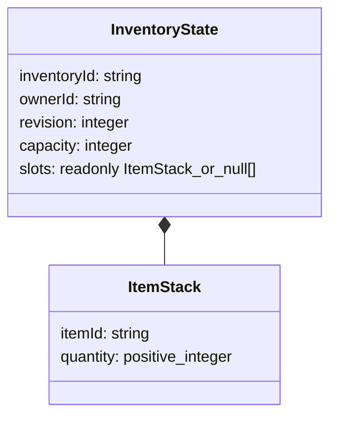

# FDS2-003 — Item Definitions & Inventory Rules

Status: **FDS2-003 PASS local**, 2026-11-07; 484 tests / 26 files, including
50 new tests. Lint, typecheck, production build and whitespace checks pass.
Only pure domain rules, not inventory UI, loot, crafting, farming or economy.

## Entry checkpoint and architecture

Clean main at `92ddfdf4d81f97e09db7cee2b8b90c4fe12ca155`, containing FDS2-002.
Before starting, Codex read GitHub API and verified Development Quality
[run 42353307430](https://github.com/chienng1512k6-ng/Trang-Trai/actions/runs/42353307430)
completed/success on that exact SHA. The first sandbox connection failed; approved
read-only retry succeeded. This is baseline CI, not CI for new uncommitted code.

- [items.ts](../apps/game/src/core/items.ts): ItemDefinition, immutable registry,
  built-in prototype catalog and small strict data-shape predicates.
- [inventory.ts](../apps/game/src/core/inventory.ts): InventoryState, validation,
  creation, five pure operations and application command boundary.
- [inventory.test.ts](../apps/game/src/core/inventory.test.ts): registry/state,
  arithmetic, ownership/revision, atomicity, immutability and conservation tests.

ID validation and ValidationResult reuse FDS2-001. No Phaser, DOM, localStorage,
clock, randomness, backend, dependency, shared-package scaffold or production
entry import. No Player/Monster/Combat/Camera/Collision/asset changes. A single
game package still does not justify moving domain code to a shared workspace.

## Item Registry

ItemDefinition has exactly itemId, displayName, category, stackable and maxStack.
IDs use the FDS2-001 ASCII identifier grammar; duplicate IDs are rejected rather
than replacing a definition. Display name is 1–80 characters without outer
whitespace. Supported prototype categories: material, seed and food. No price,
craft recipe, weapon stats or entitlement properties are accepted.

| itemId | Display name | Category | Stackable | maxStack |
|---|---|---|---|---:|
| wood | Wood | material | yes | 99 |
| stone | Stone | material | yes | 99 |
| seed | Seed | seed | yes | 50 |
| berry | Berry | food | yes | 20 |
| slime-gel | Slime Gel | material | yes | 99 |

These are sample definitions, not items granted to Player or drop tables. All
five happen to be stackable; a non-stackable test fixture validates maxStack=1.
maxStack is a positive safe integer; non-stackable definitions require exactly 1.
Registry creation takes unknown data and returns ValidationResult. Validated
definitions are copied/frozen into a private Map; get/list expose frozen records
and list returns a frozen array. There is no registry mutation method or command.
An empty registry is valid but permits no item stacks. Caller must choose the
trusted registry at composition; no definition input belongs in client mutations.
Local code control is not an anti-tampering/security boundary.

## InventoryState and slot model

createInventory(inventoryId, ownerId, capacity=20) returns a validated revision-0
empty DTO. Capacity is configurable from 1 to 1000; 1000 is an explicit prototype
allocation/validation budget, not a purchased-slot mechanic. IDs use the same
grammar as GameState. Revision is a nonnegative safe integer.

slots is dense and its length equals capacity. Indices are zero-based integers
in [0,capacity). **null alone means empty**; holes, undefined and zero-quantity
stacks are invalid. A stack has exactly itemId/quantity; item must exist in the
selected registry, quantity must be a positive safe integer <= definition.maxStack.
No renderer/DOM object, custom stack metadata or item definition is permitted.
validateInventoryState returns a detached DTO or explicit path/message issues;
it does not normalize, clamp, drop or repair invalid input.

## Mutation contract and deterministic rules

Domain primitives addItem/removeItem/moveStack/splitStack/mergeStack accept unknown
state, their operation arguments and an optional trusted registry (default catalog).
All return `{ok:true,state:InventoryState}` or `{ok:false,code:InventoryErrorCode}`.
They validate before mutation, work on a detached candidate, and commit by returning
a new DTO only when the entire operation succeeds. The caller owns applying it.
There is no live global inventory store. On failure no input field, slot or
revision changes and no partial candidate is returned.

| Operation | Rule |
|---|---|
| addItem(state,itemId,quantity) | Fill existing matching stacks in ascending slot order, then empty slots ascending. Quantity may span several stacks. Reject entire addition if all capacity is insufficient |
| removeItem(state,itemId,quantity) | Consume matching stacks ascending; replace depleted stacks with null. Reject entire removal if total quantity is insufficient |
| moveStack(state,from,to) | Move whole nonempty source to empty destination only; no implicit swap or merge |
| splitStack(state,from,to,quantity) | Move positive quantity to empty destination, strictly less than source quantity so source remains nonempty. Non-stackable stacks cannot split |
| mergeStack(state,from,to) | Both nonempty, same itemId; move entire source into destination only if combined stack fits. No partial merge or auto overflow distribution |

Same-slot move/split/merge is rejected, not a successful no-op. Zero quantities
are rejected. Every successful operation increases revision **exactly once**, even
if it touches multiple slots; failures/no-ops never increase it. Exhausted safe
revision fails explicitly. Domain defaults contain no random/time dependency.

Per-stack/request quantity stays within safe integer range. Add checks available
space before summing; merge compares source <= maxStack - target before addition.
Remove/add track remaining quantity without summing all stacks. This avoids
unsafe intermediate totals even if aggregate inventory quantity exceeds a safe
Number; external audits/tests use BigInt for totals, never naive Number sums.
BigInt is not stored in InventoryState, so its fields remain JSON-compatible.

Move/split/merge conserve every item total. Add changes only the requested item's
total by exactly +quantity; remove changes it by exactly -quantity. Other items
and ownership/identity/capacity remain unchanged. Two equal inputs with the same
registry produce equal outputs. TypeScript readonly plus detached results do not
mean outputs are a cryptographically trusted or deeply frozen persistent store.

## Validation and error contract

State/definitions/commands require exact own enumerable data fields in plain
records; symbols, getters, instances and extra fields are rejected. Slot arrays
must be dense data arrays. This is an ordinary-data boundary, not a JavaScript
Proxy sandbox or network payload/resource-security layer.

Failures include invalid-state, invalid-command, invalid-context, invalid-quantity,
invalid-slot, unknown-item, inventory-full, insufficient-items, empty-slot,
occupied-slot, incompatible-item, stack-limit, same-slot, split-requires-remainder,
forbidden, wrong-target, revision-conflict, revision-overflow and
quantity-change-not-authorized. Validator results
include issues; operation failures use stable codes without echoing user secrets.
NaN, +/-Infinity, unsafe/fractional/negative quantities and invalid revisions are
rejected. Numeric strings are not coerced. Slot values are validated before use.

## Application ownership and authority boundary

InventoryCommand = one operation plus inventoryId and expectedRevision. Context
contains ownerId separately, reusing FDS2-001's authority concept. For add/remove
it must also supply authorizedQuantityChange with the exact operation type, itemId
and quantity, derived by the caller from an independently verified source/sink.
An owner-only command cannot change item quantities through this boundary.
The application
boundary applyInventoryCommand validates state and the exact command whitelist,
checks context owner matches state, target inventoryId matches, and expectedRevision
equals state revision, then invokes one primitive. Extra client definitions,
maxStack, price, owner overrides or unknown action types are rejected. The registry
is supplied by composition, not command. Validated snapshots/IDs are not proof
of ownership history, and a browser caller can forge context or state.

**Client validation is not anti-cheat, and addItem is not a reward entitlement.**
The primitives are math for an already-authorized source/sink; the boundary matches
the separate authorization but does not prove its provenance or that an item was
earned. Local code can forge this context. There is no real client
endpoint or automatic item grant. A future server must resolve item definitions
and grant/remove quantities from validated harvesting/crafting/shop/reward rules,
authenticate ownership, validate all mutations and commit atomically. Never derive
authorizedQuantityChange by copying client fields or forward arbitrary client
addItem requests into a trusted inventory service.
Trading, rewards, loot and server authority are not implemented here.

Optimistic expectedRevision rejects stale sequential commands, not concurrent
CAS, exactly-once delivery or durable duplicate-command handling. Re-evaluating
against an old copied state still produces a candidate; future authority/storage
must serialize/transactionally commit changes and define operation-ID semantics.

## Persistence boundary and later integration

Inventory is a separate DTO **not included in GameState v1**, and no inventory
serializer, adapter, migration, localStorage or autosave is added. JSON round-trip
is tested only as data-shape readiness; it does not store anything. Existing
GameState validator/codec must continue rejecting extra inventory fields.
Registry definitions are static config, not per-player saved data. Before saving
inventory, approve a separate schema-extension task: choose aggregate identity,
versioned definition compatibility, revision ownership, migration/rollback,
snapshot validation and atomic multi-domain transaction strategy. Do not overload
the existing GameState revision or silently change schemaVersion.

Later harvesting may request an authorized add; crafting requires atomic input
consumption/output capacity checks across the complete transaction, not composing
two mutations that partially commit. Shop needs a trusted wallet transaction.
None of these workflows or APIs is built. UI must render trusted display names
as text, then submit intent to an authority; this task adds no UI/input listeners.

## Verification

Tests exercise registry validity/duplicates/frozen definitions, stackability,
capacity/shape validation, all operations, atomic failure, slot bounds, numeric
limits, immutable inputs, revisions, owner/target conflicts and blocked command
definition overrides. A fixed-seed 600-operation trace checks conservation and
deterministic replay; BigInt assertions cover near-MAX_SAFE_INTEGER arithmetic.
The 39 FDS2-001 tests, 44 FDS2-002 tests and all Sprint 1 tests remain required.

Final commands/counts are recorded in
[Sprint 2](../tasks/SPRINT-02.md). No inventory browser UI/device QA is applicable
or claimed for this unwired domain; no production behavior changes or new hosted
CI result are inferred from baseline CI. No follow-on task is implemented.
