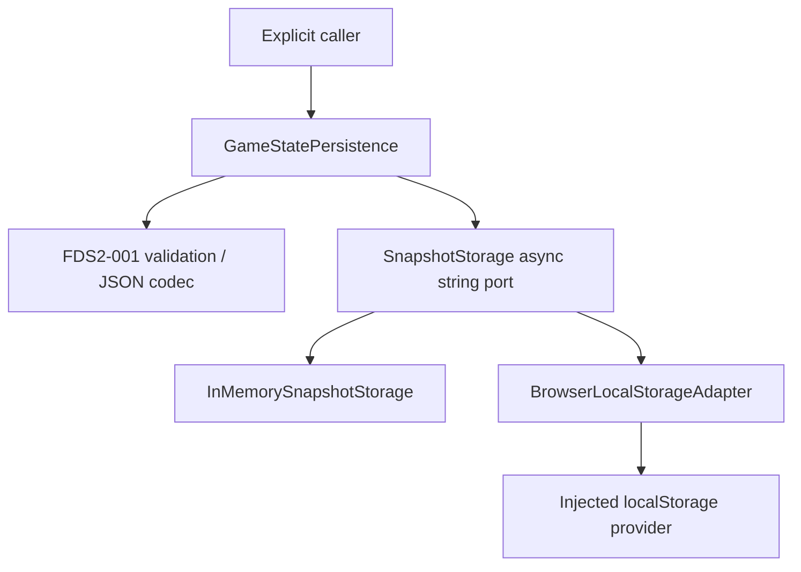

# FDS2-002 — Persistence Architecture & Storage Adapter

Status: **PASS local / embedded-browser QA**, 2026-11-07.
No autosave or gameplay integration. Only the FDS2-001 GameState envelope can be
stored; Player, Monster, combat, input, camera and assets remain unchanged.

## Entry checkpoint and decisions

Clean main at `7fddbaacfbdb4d9c3ff847b4fd9150a47e670776`, containing FDS2-001.
Before starting, Codex verified the exact head SHA of Development Quality
[run 42352432537](https://github.com/chienng1512k6-ng/Trang-Trai/actions/runs/42352432537)
as completed/success using GitHub API. Network access initially failed inside the
sandbox; an approved read-only retry succeeded. No commit/push or workflow dispatch.
That result certifies the baseline; hosted CI for these uncommitted changes is
not claimed. FDS2-001's 39 tests remain in the full regression.

Keep persistence inside apps/game until a second real consumer justifies a shared
package. The only FDS2-001 change exports its existing ID predicate under the name
isGameStateId, without changing validation/transition behavior. No dependency,
engine, TypeScript, Vite, script or CI changes.

## Architecture and interface



- [gameStatePersistence.ts](../apps/game/src/core/gameStatePersistence.ts):
  pure codec, key/identity contract, typed outcomes and persistence service.
- [InMemorySnapshotStorage.ts](../apps/game/src/storage/InMemorySnapshotStorage.ts):
  per-instance Map of strings; no global singleton or object-reference storage.
- [BrowserLocalStorageAdapter.ts](../apps/game/src/storage/BrowserLocalStorageAdapter.ts):
  structural getItem/setItem/removeItem provider, acquired only on explicit calls.
- [gameState.ts](../apps/game/src/core/gameState.ts): unchanged v1 DTO/rules;
  storage implementations and rendering do not enter the domain state.

SnapshotStorage has async read(key), write(key,string), remove(key). Async signatures
allow later async adapters without changing GameState or service call sites;
native localStorage still performs synchronous I/O and may block the main thread.
This is a small string port, not a generic repository or remote-sync framework.
The port contract requires failed writes/removes not to destroy prior bytes.
Both provided adapters comply; arbitrary third-party adapters need their own
failure guarantees/tests. Rejected adapter operations are caught by the service.

| Public operation | Success | Failure behavior |
|---|---|---|
| serializeGameState(unknown) | `{ok:true,value:json}` | invalid-state with validation issues; no I/O |
| deserializeGameState(string) | `{ok:true,value:GameState}` | malformed-json, unsupported-schema, invalid-state |
| snapshotKey(identity) | `{ok:true,value:key}` | invalid-identity |
| load(identity) | `{ok:true,status:'missing'}` or `{ok:true,status:'found',state}` | Typed failure; never create/delete/repair |
| save(unknown, expectedRevision) | `{ok:true,value:savedState}` | Validation/read/schema/identity/revision/write failure; no fallback overwrite |
| remove(identity) | `{ok:true,value:undefined}` | Typed storage/identity failure; no clear-all operation |

Failure is `{ok:false,code,issues?}`; no raw JSON, token or platform exception text
is included in errors. Ordinary-data validation is not a hostile-JavaScript sandbox.

## Identity, keys and snapshot lifecycle

SnapshotIdentity is `{gameId,farmId,ownerId}`. Each ID uses the FDS2-001 grammar.
All three components distinguish slots. Each is encodeURIComponent-encoded:

```text
farm-development:game-state:<gameId>:<farmId>:<ownerId>
```

Thus IDs containing ':' cannot collide with delimiters; a different game, farm or
owner has a different key. Owner ID here is a reference, not authenticated proof.
Namespace is stable. Schema version is deliberately NOT embedded in the key:
finding a future snapshot must prevent an older app from silently creating a
parallel v1 snapshot in its place. Payload identities must match the requested key.
No enumerating/clearing unrelated origin storage, and no secrets/auth data stored.

1. load reads one key. Null means missing, without making a new GameState.
2. Existing bytes are JSON-parsed, version-checked, validated through the existing
   strict validator and matched against the requested identity.
3. Caller decides what to do on missing/error. A failed read never causes reset.
4. save validates and encodes a detached snapshot before its first await. It then
   loads/validates the current slot and checks revision before writing once.
5. remove is explicit deletion of only that identity, including a deliberately
   selected corrupt/future-schema slot. It never runs automatically after failure.
   It returns success for an already-missing key. There is no automatic reset/new
   state constructor, backup rotation, destructive repair or recovery UI.

## Serialization and version policy

JSON contains exactly schemaVersion, gameId, farmId, ownerId, logicalTimeMs and
metadata (revision/createdAtLogicalMs/updatedAtLogicalMs). All remain unchanged by
save/load. The codec does not strip unknown fields: it rejects them before save,
preventing silent omission of runtime/renderer or future subsystem values.
Nonfinite/unsafe/fractional/negative time/revisions and invalid time ordering fail.
NaN JSON syntax is malformed-json; parsed 1e999 becomes nonfinite and fails state
validation. No clock read, Date.now, timer or time correction in implementation.

Only schemaVersion 1 is supported. A parsed integer schema other than 1 returns
unsupported-schema; missing/non-numeric versions or other invalid v1 data return
invalid-state. Malformed JSON returns malformed-json. None is treated as missing.
Unknown/corrupt stored bytes block save, including create-only requests.
No migration engine exists. A future migration should explicitly recognize the
source version, validate source, transform a copy deterministically, validate the
target and preserve original bytes until the write succeeds. Unsupported future
versions require a compatible client or explicit user-directed export/reset.
Never downgrade, coerce, or silently reset. Backup/transaction policy requires
separate design before high-value persistent data.

## Revision policy and concurrency limits

- expectedRevision **null** means create only if the slot is absent. A validated
  imported snapshot may start at any valid revision; save does not invent revision 0.
- A numeric expectedRevision must be a nonnegative safe integer matching an existing
  slot; an absent slot or mismatch fails revision-mismatch.
- Replacing an existing slot requires next revision = expected + 1, unchanged
  creation epoch, nondecreasing logicalTimeMs and updatedAtLogicalMs. Overflow,
  rollback, skipped/unchanged revision or changed creation time fails
  non-advancing-state. New fields/transitions later may change domain data without
  advancing time; save does not impose FDS2-001's clock-command-only semantics.
- Identical save retry is not an idempotent success: once revision changes, the
  old expected revision fails. Caller must reload/reconcile, not blind retry.

**Read/compare/write is not atomic CAS.** Multiple tabs, service instances or
concurrent async calls can both read revision n and write competing revision n+1.
A regression explicitly demonstrates this limitation. No locks, transaction,
storage-event listener, distributed coordination or durable operation-ID ledger.
Sequential revision checking catches ordinary stale callers only. Future trusted
storage must provide transactional compare-and-swap/idempotency at its authority;
changing adapters alone cannot make this client service server-authoritative.

## Storage errors and security

Browser provider/getItem/setItem/removeItem are wrapped. QuotaExceededError and
NS_ERROR_DOM_QUOTA_REACHED map to quota-exceeded; access-policy/security/provider
or other storage errors map to storage-unavailable. Generic rejected adapters map
to storage-unavailable. Save never removes old data first or attempts a destructive
rollback; supplied adapters preserve prior bytes on failed writes. A failed read
does not write. Explicit remove has its own errors and no broad storage.clear().

All client storage is editable, origin-scoped and untrusted. Validation cannot
prove owner entitlement, time provenance, revision history or prevent replay from
an older copied snapshot. Do not store secrets, access/refresh tokens, credentials,
trusted currency/inventory/entitlements. Persistent-intent IDs are not login.
No encryption, authentication, cloud sync, server validation, durability against
browser eviction/user clearing, or guarantee of quota/private-mode availability.
Different scheme/host/port origins have separate stores; localhost and LAN IP do
not automatically share data. A private/blocked browser can reject operations.

## Explicit composition example — not automatic gameplay code

```typescript
const persistence = new GameStatePersistence(
    new BrowserLocalStorageAdapter(() => window.localStorage),
);
const loaded = await persistence.load({ gameId, farmId, ownerId });
// Caller must branch on loaded.ok, then missing/found. Never reset on any error.
// Explicit caller-supplied valid envelope: save(state, null) creates an absent slot.
// Existing slot: save(nextState, previousState.metadata.revision).
```

The provider is injected, so even obtaining localStorage (which may throw) happens
inside an adapter operation rather than module import. Neither domain module
requires Phaser, DOM or browser globals. No production bootstrap is changed.
Later integration must choose explicit new/load/reset UX, handle unsupported and
corrupt data visibly, validate before applying domain state, separate runtime
actors from saved fields, and define save timing/budget. Autosave, lifecycle hooks
and reconnect/offline progression require separate approval and tests. FDS2-003
inventory and future authoritative economic data are not implemented here.

## Verification — 2026-11-07

- Root lint/typecheck/test/build: PASS. **434 tests / 25 files**, 44 new persistence
  tests plus all prior 390 (including 39 FDS2-001 contract tests). Detailed commands
  and final whitespace check are in [Sprint 2](../tasks/SPRINT-02.md).
- Tests cover both adapters' round trips, missing/identity isolation and encoded
  key collisions, exact logical times, malformed/incompatible/invalid data,
  protected old bytes, revisions, rollback, explicit scoped removal, unavailable
  provider/read/write/remove, quota names, generic async errors, detached snapshot,
  memory-instance isolation, no DOM imports and non-atomic concurrent saves.
- Embedded-browser QA: Windows x64, Code 1.145.1 / Electron 43.8.3 /
  Chromium 150.0.7871.250; **development server** http://localhost:8080/.
  Explicit dynamic imports in DevTools automation invoked the actual adapters with
  native localStorage. A unique QA slot was missing, saved, page-reloaded, and loaded
  with exact logicalTimeMs 123, revision 0 and identical fields. Setting that QA
  slot to schema 2 produced unsupported-schema on load and save, retaining schema
  2. Explicit remove returned missing afterward. The temporary QA key was removed;
  no other slots were touched. One game canvas remained; no page/console errors
  or HTTP >=400 responses captured during the reload verification.
- This is an actual embedded browser's native storage, not a unit mock, independent
  Chrome or real iPhone Safari. Independent Chrome, Safari/iPhone persistence,
  eviction/private-mode/quota behavior on physical devices and production-browser
  persistence QA are **NOT TESTED**. No real-device PASS or new performance metric.
- No new browser fixture, debug global or save UI ships. Production entry does
  not import the seam; no autosave. No dependency upgrade, backend or FDS2-003 work.
